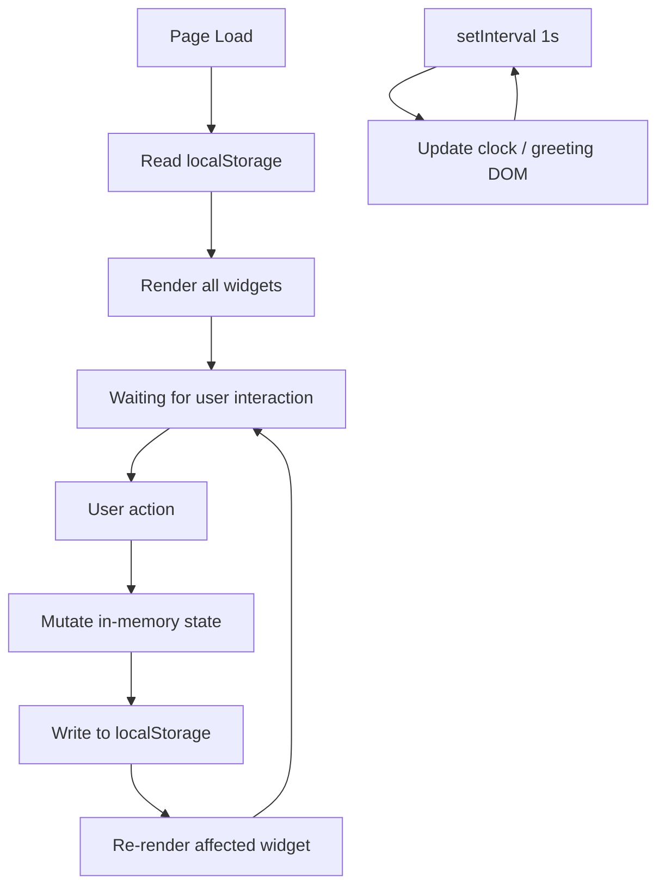

# Design Document

## Overview

The To-do List Life Dashboard is a zero-dependency, single-page web application that runs entirely in the browser. It presents four widgets on one HTML page: a live greeting with the current time and date, a 25-minute Pomodoro-style focus timer, a persistent to-do list, and a customizable quick-links panel.

No build tooling, bundler, or server is needed. Opening `index.html` in any modern browser is sufficient. All persistent state is stored in `localStorage`.

The project is deliberately constrained to exactly three files:

```
index.html
css/style.css
js/app.js
```

Every widget is implemented in these three files. No external scripts, stylesheets, or CDN resources are loaded at runtime.

---

## Architecture

The application follows a **state → render** cycle driven by vanilla JavaScript:

1. On page load, state is hydrated from `localStorage`.
2. User interactions mutate the in-memory state object.
3. After every mutation, the affected portion of the DOM is re-rendered from state, and state is persisted back to `localStorage`.
4. The clock widget runs on a 1-second `setInterval` that reads the system clock and updates only the Greeting widget DOM nodes.



### State Ownership

All mutable state lives in a single module-level object in `app.js`:

```js
const state = {
  tasks: [],   // Task[]
  links: [],   // Link[]
  timer: {
    remaining: 1500,   // seconds
    running: false,
    expired: false
  }
};
```

The clock and date values are read directly from `new Date()` and are never stored in state or `localStorage`.

### Error Boundaries

Two categories of runtime error are handled explicitly:

- **`localStorage` unavailable**: Detected once on load using a try/catch probe. A persistent banner is shown; the app operates on in-memory state for the session.
- **Corrupted `localStorage` data**: Caught during JSON.parse on load. Corrupted data is discarded, an error message is shown, and the widget renders empty.

---

## Components and Interfaces

All components live in `app.js` as plain functions grouped by widget. They share the single `state` object and a small set of helper utilities.

### Module Layout (`app.js`)

```
── Utilities
   ├── storageAvailable()          → boolean
   ├── saveToStorage(key, value)   → void (handles quota/error)
   ├── loadFromStorage(key)        → any | null
   └── sanitizeText(str)           → string (trim + length guard)

── Greeting Widget
   ├── initClock()                 → starts setInterval
   ├── tickClock()                 → reads Date, updates DOM
   └── getGreeting(hour)           → string

── Focus Timer Widget
   ├── initTimer()                 → renders initial state
   ├── startTimer()                → sets interval, flips state.timer.running
   ├── stopTimer()                 → clears interval, flips state.timer.running
   ├── resetTimer()                → stops, resets remaining to 1500, clears expired
   └── tickTimer()                 → decrements remaining; triggers expiry at 0

── Todo List Widget
   ├── renderTasks()               → full re-render of task list DOM
   ├── addTask(description)        → validates, pushes to state.tasks, persists, re-renders
   ├── editTask(id, newDescription)→ validates, updates state.tasks, persists, re-renders
   ├── toggleTask(id)              → flips completed, persists, re-renders
   ├── deleteTask(id)              → removes from state.tasks, persists, re-renders
   └── hydrateTasks()              → loads from localStorage into state.tasks

── Quick Links Widget
   ├── renderLinks()               → full re-render of links panel DOM
   ├── addLink(label, url)         → validates, normalizes URL, pushes, persists, re-renders
   ├── deleteLink(id)              → removes from state.links, persists, re-renders
   └── hydrateLinks()              → loads from localStorage into state.links

── Bootstrap
   └── init()                      → called on DOMContentLoaded; hydrates, renders, starts clock
```

### DOM Interface

Each widget owns a single container element identified by a stable `id`:

| Widget | Container ID |
|---|---|
| Greeting | `#greeting-widget` |
| Focus Timer | `#timer-widget` |
| Todo List | `#todo-widget` |
| Quick Links | `#links-widget` |

Re-render functions replace the `innerHTML` of their container. No virtual DOM or diffing is used; widgets are small enough that full replacement is imperceptible.

### User-Facing Controls

| Control | Element | Widget |
|---|---|---|
| Task input field | `<input id="task-input">` | Todo |
| Add task button | `<button id="add-task-btn">` | Todo |
| Edit task button | `<button class="edit-btn">` | Todo (per task) |
| Complete toggle | `<button class="complete-btn">` | Todo (per task) |
| Delete task button | `<button class="delete-btn">` | Todo (per task) |
| Link label input | `<input id="link-label-input">` | Quick Links |
| Link URL input | `<input id="link-url-input">` | Quick Links |
| Add link button | `<button id="add-link-btn">` | Quick Links |
| Delete link button | `<button class="delete-link-btn">` | Quick Links (per link) |
| Start/Stop timer | `<button id="timer-start-stop">` | Focus Timer |
| Reset timer | `<button id="timer-reset">` | Focus Timer |

---

## Data Models

### Task

```js
/**
 * @typedef {Object} Task
 * @property {string} id          - UUID generated at creation (crypto.randomUUID or Date.now fallback)
 * @property {string} description - Non-empty, trimmed, max 500 characters
 * @property {boolean} completed  - false by default
 * @property {number} createdAt   - Unix timestamp (ms) used to preserve insertion order
 */
```

Tasks are stored in `localStorage` under the key `"tasks"` as a JSON-serialized `Task[]` array.

### Link

```js
/**
 * @typedef {Object} Link
 * @property {string} id    - UUID generated at creation
 * @property {string} label - 1–50 characters, trimmed
 * @property {string} url   - 1–2048 characters; always starts with http:// or https://
 */
```

Links are stored in `localStorage` under the key `"links"` as a JSON-serialized `Link[]` array.

### Timer State

The timer state is **not persisted**. It resets to `25:00` on every page load. This is intentional: a Pomodoro timer carries no meaningful state across sessions.

```js
/**
 * @typedef {Object} TimerState
 * @property {number}  remaining - Seconds left; initializes to 1500 (25 * 60)
 * @property {boolean} running   - Whether the countdown interval is active
 * @property {boolean} expired   - True when remaining reaches 0; cleared on reset
 */
```

### Validation Rules (applied before any mutation)

| Field | Rule |
|---|---|
| Task description (add) | `trimmed.length >= 1 && trimmed.length <= 500` |
| Task description (edit) | same as add |
| Link label | `trimmed.length >= 1 && trimmed.length <= 50` |
| Link URL | `trimmed.length >= 1 && trimmed.length <= 2048` |
| Link URL protocol | if not starting with `http://` or `https://`, prepend `https://` |

---

## Correctness Properties

*A property is a characteristic or behavior that should hold true across all valid executions of a system — essentially, a formal statement about what the system should do. Properties serve as the bridge between human-readable specifications and machine-verifiable correctness guarantees.*

### Property 1: Task addition grows the task list

*For any* task list and any non-empty, non-whitespace-only description of at most 500 characters, calling `addTask` with that description shall result in `state.tasks` having exactly one more entry than before, and the new entry shall contain the submitted description (trimmed).

**Validates: Requirements 3.1**

### Property 2: Whitespace-only and oversized descriptions are rejected

*For any* string that is composed entirely of whitespace characters, or whose trimmed length exceeds 500 characters, calling `addTask` or `editTask` with that string shall leave `state.tasks` unchanged.

**Validates: Requirements 3.2, 3.5**

### Property 3: Task toggling is an involution

*For any* task in `state.tasks`, calling `toggleTask` twice on the same task ID shall return that task to its original `completed` value (round-trip / idempotence).

**Validates: Requirements 3.7, 3.8**

### Property 4: Task persistence round-trip

*For any* sequence of `addTask`, `editTask`, `toggleTask`, and `deleteTask` operations, serializing `state.tasks` to JSON and then deserializing it shall produce a task collection that is deeply equal to the pre-serialization collection.

**Validates: Requirements 4.1**

### Property 5: Greeting message covers every hour of the day

*For any* integer hour in the range [0, 23], `getGreeting(hour)` shall return exactly one of "Good Morning", "Good Afternoon", "Good Evening", or "Good Night", and the four ranges shall partition [0, 23] without gaps or overlaps.

**Validates: Requirements 1.3, 1.4, 1.5, 1.6**

### Property 6: URL protocol normalization

*For any* URL string that does not begin with `"http://"` or `"https://"`, `addLink` shall save a URL that begins with `"https://"` and is otherwise identical to the original input (trimmed).

**Validates: Requirements 5.3**

### Property 7: Link persistence round-trip

*For any* sequence of `addLink` and `deleteLink` operations, serializing `state.links` to JSON and then deserializing it shall produce a link collection that is deeply equal to the pre-serialization collection.

**Validates: Requirements 6.1, 6.2**

### Property 8: Timer countdown is monotonically decreasing

*For any* started timer, each successive call to `tickTimer` shall decrease `remaining` by exactly 1, until `remaining` reaches 0, at which point `expired` shall be set to `true` and `remaining` shall not decrease further.

**Validates: Requirements 2.2, 2.6**

---

## Error Handling

### `localStorage` Unavailable

Detected with a probe call inside a `try/catch` block during `init()`. If unavailable:

- A persistent, non-dismissable banner is rendered at the top of the page: *"Your browser does not support local storage. Data will not be saved."*
- All `saveToStorage` calls become no-ops.
- All `loadFromStorage` calls return `null`.
- The app remains fully functional for the session using only in-memory state.

### Corrupted `localStorage` Data

`JSON.parse` is wrapped in a `try/catch` inside `loadFromStorage`. If parsing fails:

- The corrupted key is removed from `localStorage`.
- The hydration function returns an empty array.
- A transient error message is displayed in the affected widget: *"Saved data could not be loaded and has been cleared."*
- The widget renders in its empty initial state.

### `localStorage` Write Failure (Quota Exceeded)

`localStorage.setItem` is wrapped in a `try/catch` inside `saveToStorage`. If the write fails:

- The in-memory state is already up-to-date (the mutation happened before persistence).
- A transient error message is displayed in the affected widget: *"Changes could not be saved."*
- The UI reflects the current in-memory state so the user can keep working for the session.

### Input Validation Failures

Validation errors are shown inline, adjacent to the relevant input field:

- Empty or whitespace-only task → *"Task cannot be empty."*
- Task over 500 characters → *"Task must be 500 characters or fewer."*
- Empty label or URL → field-specific message indicating which field is invalid.
- Edit confirmed with invalid text → input is restored to the original text.

The focus ring is retained on the input field after all validation rejections.

---

## Testing Strategy

### Approach

This project is pure vanilla JavaScript with no build step. Testing targets the logic layer (`app.js`) directly by loading it in a `jsdom` environment via **Jest** (or, as a lightweight alternative, **Vitest** in a jsdom mode). No framework-specific tooling is needed.

**PBT is appropriate here**: the core logic (validation, serialization, greeting bucketing, URL normalization, timer counting) consists of pure or near-pure functions whose behavior varies meaningfully with input, and 100 iterations are cheap to run in-memory.

### Chosen Libraries

| Purpose | Library |
|---|---|
| Test runner | [Vitest](https://vitest.dev/) (zero-config, ESM-friendly) |
| Property-based testing | [fast-check](https://fast-check.dev/) |
| DOM environment | `jsdom` (Vitest built-in via `environment: 'jsdom'`) |

### Unit Tests

Unit tests cover specific examples and edge cases that complement the property tests:

- Timer displays `25:00` on init.
- Timer ignores Start when already running (Requirement 2.8).
- Timer Stop preserves current value (Requirement 2.3).
- Reset from running state restores to `25:00` (Requirement 2.5).
- `getGreeting` returns correct string for representative hours (05, 12, 18, 21, 00).
- `loadFromStorage` returns `null` when key is absent.
- `loadFromStorage` returns `null` and removes the key when stored value is malformed JSON.
- Adding a link without a protocol stores a URL prefixed with `https://`.

### Property-Based Tests

Each property test runs a minimum of **100 iterations** (fast-check default: 100). Tags are included as comments per the format `Feature: todo-life-dashboard, Property N: <text>`.

| Property | Test Description |
|---|---|
| Property 1 | Generate random valid descriptions; verify task list grows by 1 and new task has trimmed description |
| Property 2 | Generate whitespace-only and oversized strings; verify `state.tasks` is unchanged |
| Property 3 | Generate random task IDs; toggle twice; verify `completed` is restored to original value |
| Property 4 | Generate random task arrays; serialize and deserialize; verify deep equality |
| Property 5 | Generate all integers 0–23; verify `getGreeting` returns a non-empty string and the four ranges partition [0,23] |
| Property 6 | Generate random URL strings without a valid protocol; verify saved URL starts with `https://` |
| Property 7 | Generate random link arrays; serialize and deserialize; verify deep equality |
| Property 8 | Generate a random starting value in [1, 1500]; tick until expiry; verify every step decremented by 1 and `expired` set at 0 |

### Integration / Smoke Tests

- Dashboard renders all four widgets with no console errors when `index.html` is opened in a browser (manual smoke test).
- `localStorage` fallback banner appears when `localStorage` is stubbed to throw (manual test or Vitest `vi.spyOn` on `localStorage.setItem`).
